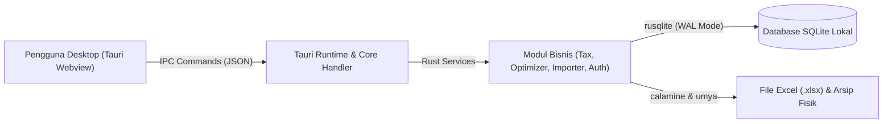

# Arsitektur, API, dan Model Data: Anda ERP

## 1. Gambaran Sistem



Aplikasi menggunakan arsitektur desktop Tauri v2. Antarmuka pengguna berbasis HTML5, CSS kustom, dan Vanilla JavaScript berkomunikasi dengan backend Rust melalui IPC invocations bertipe aman. Backend menangani kalkulasi pajak, manipulasi basis data SQLite lokal, pembacaan dan penulisan berkas Excel, serta komputasi rekonsiliasi audit target. Seluruh data disimpan secara lokal pada mesin pengguna tanpa dependensi server awan eksternal.

---

## 2. Konfigurasi Lingkungan & Penyimpanan

Aplikasi menggunakan direktori data lokal terstandarisasi berdasarkan sistem operasi pengguna:

| Parameter | Jalur / Nilai Default | Kegunaan |
| :--- | :--- | :--- |
| **Lokasi Database** | `com.andabungalows.erp/laporan_bapenda.sqlite` | Berkas database SQLite utama |
| **Direktori Arsip** | `com.andabungalows.erp/arsip_excel/` | Salinan fisik berkas spreadsheet yang diimpor |
| **Aset Sertifikat** | `com.andabungalows.erp/cert_assets/` | Gambar PNG/JPEG kustom untuk logo dan tanda tangan digital opsional |
| **Mode SQLite** | `PRAGMA journal_mode=WAL` | Menjamin konkurensi baca-tulis tinggi dan crash-safe |
| **Skema Synchronous** | `PRAGMA synchronous=NORMAL` | Keseimbangan integritas ACID dan kecepatan tulis disk |

---

## 3. Kontrak Tauri IPC Commands

Seluruh pemanggilan dari antarmuka pengguna dilakukan melalui pembungkus `invoke(command, args)`:

| Perintah IPC | Parameter Masukan | Tipe Balikan | Kegunaan |
| :--- | :--- | :--- | :--- |
| `auth_login` | `{ username, pin }` | `UserProfile` | Memvalidasi PIN dan mengembalikan profil pengguna |
| `auth_logout` | `{}` | `()` | Mengosongkan sesi pengguna aktif pada `AppState` backend |
| `auth_list_users` | `{}` | `Vec<UserRow>` | Mengambil daftar akun pengguna terdaftar |
| `auth_create_user` | `{ username, fullName, role, pin }` | `i64` | Membuat akun pengguna baru |
| `auth_delete_user` | `{ targetUserId, currentUserId? }` | `()` | Menghapus akun pengguna selain admin yang sedang login (khusus Admin dari `AppState`) |
| `get_available_months` | `{ unit? }` | `Vec<String>` | Mengambil daftar periode bulan yang memiliki transaksi atau data reservasi kamar |
| `get_tax_recap` | `{ unit, month }` | `TaxRecapReport` | Mengambil data rekapitulasi kalender harian bulanan |
| `get_tourism_report` | `{ unit, month, roomCapacity? }` | `TourismFormReport` | Menghasilkan statistik Form 1 Dinas Pariwisata (4 minggu, occupied/vacant, negara/daerah asal, rata-rata lama tinggal) |
| `print_report` | `{ title? }` | `()` | Membuka dialog pencetakan sistem dan menyinkronkan judul |
| `set_window_title` | `{ title }` | `()` | Mengubah judul jendela sistem macOS / desktop |
| `get_transactions` | `{ unit, month?, search?, page?, pageSize? }` | `TransactionPage` | Mengambil transaksi dengan paginasi dan filter pencarian |
| `get_room_reservations` | `{ unit?, month?, search?, page?, pageSize? }` | `PaginatedRoomReservations` | Mengambil data rincian reservasi kamar 13 kolom dengan paginasi, filter pencarian, dan ringkasan metrik |
| `add_transaction` | `{ unit, date, amount, description? }` | `i64` | Menyimpan transaksi manual baru |
| `update_transaction` | `{ id, unit, date, amount, description? }` | `()` | Memperbarui transaksi yang sudah ada (khusus Admin) dan menyinkronkan reservasi terkait beserta nilai `rate` |
| `delete_transaction` | `{ id }` | `()` | Menghapus baris transaksi tertentu beserta reservasi terkait (khusus Admin) |
| `update_room_reservation` | `{ payload }` | `()` | Memperbarui rincian reservasi 13 kolom secara atomik dan menyinkronkan transaksi terkait (khusus Admin) |
| `delete_room_reservation` | `{ id }` | `()` | Menghapus rincian reservasi 13 kolom beserta transaksi terkait secara atomik (khusus Admin) |
| `export_room_reservations_excel` | `{ unit?, month? }` | `String` | Mengekspor data reservasi 13 kolom aktif ke berkas `.xlsx` siap impor |
| `get_origin_reference_list` | `{}` | `OriginReferenceList` | Mengambil daftar referensi 60 daerah Indonesia dan ~198 negara dunia untuk autocomplete UI |
| `delete_period_transactions` | `{ unit, startDate, endDate }` | `usize` | Menghapus transaksi dan reservasi dalam rentang tanggal secara atomik (khusus Admin) |
| `clean_duplicate_transactions` | `{ unit? }` | `usize` | Menghapus transaksi bernominal dan tanggal ganda (khusus Admin) |
| `preview_import_file` | `{ filePath, targetUnit }` | `ImportPreview` | Memvalidasi dan melihat sampel data sebelum diimpor |
| `import_excel_file` | `{ filePath, options }` | `ImportResult` | Mengimpor data Excel ke basis data dan menyimpan arsip |
| `download_excel_template` | `{ unit? }` | `String` | Menghasilkan berkas template Excel kosong siap pakai |
| `get_import_logs` | `{ unit? }` | `Vec<ImportLogRow>` | Mengambil riwayat impor berkas fisik |
| `analyze_excel` | `{ filePath }` | `ExcelAnalysis` | Membaca struktur berkas Excel untuk solver audit target |
| `solve_subset` | `{ items, options }` | `SolverResult` | Menjalankan algoritma optimasi subset sum |
| `export_excel` | `{ sourcePath, destinationPath, items, selectedIndices }` | `String` | Menulis solusi kombinasi baris ke kolom E dan F file Excel |
| `get_settings` | `{}` | `SettingsRow` | Mengambil pengaturan profil usaha dan tarif pajak |
| `update_settings` | `{ settings }` | `()` | Memperbarui profil usaha dan tarif pajak |
| `get_storage_info` | `{}` | `StorageInfo` | Mengambil statistik ukuran basis data dan arsip berkas |
| `backup_database_dialog` | `{}` | `String` | Membuka dialog penyimpanan salinan cadangan `.sqlite` |
| `restore_database_dialog` | `{}` | `String` | Memulihkan basis data dari berkas cadangan pengguna |
| `get_units` | `{}` | `Vec<UnitRow>` | Mengambil daftar unit usaha aktif |
| `add_unit` | `{ code, name, defaultNpwpd?, defaultAddress? }` | `i64` | Menambah unit usaha baru |
| `update_unit` | `{ id, name, defaultNpwpd?, defaultAddress?, isActive }` | `()` | Memperbarui data unit usaha |
| `get_certificates` | `{ year?, status?, search?, page?, pageSize? }` | `PaginatedCertificates` | Mengambil riwayat sertifikat training dengan filter tahun, status, pencarian, dan paginasi |
| `get_certificate_years` | `{}` | `Vec<String>` | Mengambil daftar tahun terbit sertifikat unik menurun |
| `get_next_certificate_no` | `{ year?, month?, departmentCode? }` | `String` | Menghasilkan pratinjau nomor urut `NNN/ABR-{DEPT}/{ROMAWI}/{TAHUN}` berikutnya |
| `create_certificate` | `{ payload }` | `TrainingCertificateRow` | Memvalidasi, mengalokasikan nomor urut atomik bila otomatis, dan menyimpan sertifikat baru |
| `update_certificate` | `{ id, payload }` | `TrainingCertificateRow` | Memperbarui data sertifikat tersimpan dengan `certificate_no` terkunci pasca terbit dan validasi durasi divisi (khusus Admin) |
| `set_certificate_status` | `{ id, status }` | `TrainingCertificateRow` | Mengubah status sertifikat `active` atau `revoked` (khusus Admin) |
| `delete_certificate` | `{ id }` | `()` | Menghapus permanen rekaman sertifikat (khusus Admin) |
| `preview_certificate_svg` | `{ payload }` | `String` | Menghasilkan dokumen SVG kanonik F4/A4 untuk pratinjau langsung |
| `export_certificate_pdf` | `{ payload }` | `String` | Mengekspor sertifikat PDF vektor presisi milimeter lewat dialog simpan berkas |
| `export_certificate_png` | `{ payload }` | `String` | Mengekspor gambar PNG resolusi 300 DPI lewat dialog simpan berkas |
| `get_certificate_settings` | `{}` | `CertificateSettingsPayload` | Mengambil pengaturan penandatangan bawaan, kota terbit, template kalimat, kertas, dan URI aset |
| `update_certificate_settings` | `{ signerName, signerTitle, programName, paperSize, showSignature, issuedCity?, bodyTemplate? }` | `CertificateSettingsPayload` | Menyimpan pengaturan default sertifikat (khusus Admin) |
| `upload_certificate_asset` | `{ kind }` | `CertificateSettingsPayload` | Memvalidasi magic byte/ukuran dan mengunggah aset PNG/JPEG `logo` atau `signature` (khusus Admin) |
| `clear_certificate_asset` | `{ kind }` | `CertificateSettingsPayload` | Menghapus aset kustom dan kembali ke logo bawaan / tanda tangan basah (khusus Admin) |
| `print_certificate` | `{ title? }` | `()` | Membuka dialog pencetakan sistem landscape tanpa margin (borderless) untuk sertifikat |
| `get_departments` | `{}` | `Vec<DepartmentRow>` | Mengambil daftar departemen hospitality beserta deskripsi program dan daftar kompetensinya |
| `save_department` | `{ payload }` | `DepartmentRow` | Menambah atau memperbarui data departemen hospitality (khusus Admin) |
| `delete_department` | `{ id }` | `()` | Menghapus departemen hospitality dari database (khusus Admin) |
| `get_program_types` | `{}` | `Vec<ProgramTypeRow>` | Mengambil daftar jenis program pelatihan beserta durasi standarnya |
| `save_program_type` | `{ payload }` | `ProgramTypeRow` | Menambah atau memperbarui jenis program sertifikat (khusus Admin) |
| `delete_program_type` | `{ id }` | `()` | Menghapus jenis program sertifikat dari database (khusus Admin) |

---

## 4. Model Data Basis Data Lokal (SQLite)

### Tabel `units`
Menyimpan identitas unit usaha bisnis.
```sql
CREATE TABLE IF NOT EXISTS units (
    id INTEGER PRIMARY KEY AUTOINCREMENT,
    code TEXT NOT NULL UNIQUE COLLATE NOCASE,
    name TEXT NOT NULL,
    default_npwpd TEXT,
    default_address TEXT,
    is_active INTEGER NOT NULL DEFAULT 1,
    created_at TEXT NOT NULL DEFAULT (datetime('now', 'localtime'))
);
```

### Tabel `transactions`
Menyimpan data mentah catatan pendapatan harian.
```sql
CREATE TABLE IF NOT EXISTS transactions (
    id INTEGER PRIMARY KEY AUTOINCREMENT,
    unit TEXT NOT NULL COLLATE NOCASE,
    date TEXT NOT NULL,
    amount REAL NOT NULL,
    description TEXT,
    category TEXT,
    created_at TEXT NOT NULL DEFAULT (datetime('now', 'localtime')),
    FOREIGN KEY(unit) REFERENCES units(code)
);
CREATE INDEX IF NOT EXISTS idx_transactions_lookup ON transactions(unit, date);
```

### Tabel `import_logs`
Menyimpan jejak audit riwayat berkas spreadsheet yang diimpor.
```sql
CREATE TABLE IF NOT EXISTS import_logs (
    id INTEGER PRIMARY KEY AUTOINCREMENT,
    unit TEXT NOT NULL,
    file_name TEXT NOT NULL,
    file_hash TEXT,
    records_count INTEGER NOT NULL,
    total_amount REAL NOT NULL,
    period TEXT NOT NULL,
    stored_path TEXT NOT NULL,
    imported_at TEXT NOT NULL DEFAULT (datetime('now', 'localtime'))
);
```

### Tabel `settings`
Menyimpan parameter konfigurasi profil wajib pajak dan tarif.
```sql
CREATE TABLE IF NOT EXISTS settings (
    key TEXT PRIMARY KEY,
    value TEXT NOT NULL
);
```

### Tabel `users`
Menyimpan kredensial autentikasi pengguna aplikasi.
```sql
CREATE TABLE IF NOT EXISTS users (
    id INTEGER PRIMARY KEY AUTOINCREMENT,
    username TEXT NOT NULL UNIQUE COLLATE NOCASE,
    full_name TEXT NOT NULL,
    role TEXT NOT NULL DEFAULT 'staff',
    pin_salt TEXT NOT NULL,
    pin_hash TEXT NOT NULL,
    created_at TEXT NOT NULL DEFAULT (datetime('now', 'localtime')),
    last_login TEXT
);
```

### Tabel `room_reservations`
Menyimpan 13 atribut data terstruktur reservasi kamar tamu untuk modul operasional masa depan.
```sql
CREATE TABLE IF NOT EXISTS room_reservations (
    id INTEGER PRIMARY KEY AUTOINCREMENT,
    unit TEXT NOT NULL DEFAULT 'Bungalows',
    transaction_id INTEGER REFERENCES transactions(id) ON DELETE CASCADE,
    date TEXT NOT NULL,
    guest_name TEXT NOT NULL,
    total_person INTEGER,
    booking_number TEXT,
    nationality TEXT,
    room_number TEXT,
    total_rooms INTEGER NOT NULL DEFAULT 1,
    check_in_date TEXT NOT NULL,
    check_out_date TEXT NOT NULL,
    total_nights INTEGER,
    rate REAL,
    total_payment REAL NOT NULL,
    remarks TEXT,
    source_file TEXT,
    created_at DATETIME DEFAULT (datetime('now', 'localtime'))
);
CREATE INDEX IF NOT EXISTS idx_room_res_date ON room_reservations(date);
CREATE INDEX IF NOT EXISTS idx_room_res_checkin ON room_reservations(check_in_date);
CREATE INDEX IF NOT EXISTS idx_room_res_unit_date ON room_reservations(unit, date);
CREATE INDEX IF NOT EXISTS idx_room_res_trans_id ON room_reservations(transaction_id);
```

### Tabel `training_certificates`
Menyimpan riwayat sertifikat training peserta, nomor unik tahunan, kode departemen dan jenis program, kota terbit, snapshot template kalimat, status, dan ukuran kertas.
```sql
CREATE TABLE IF NOT EXISTS training_certificates (
    id INTEGER PRIMARY KEY AUTOINCREMENT,
    certificate_no TEXT NOT NULL UNIQUE COLLATE NOCASE,
    recipient_name TEXT NOT NULL,
    duration_text TEXT NOT NULL,
    program_name TEXT NOT NULL DEFAULT 'hospitality training program',
    start_date TEXT NOT NULL,
    end_date TEXT NOT NULL,
    issued_date TEXT NOT NULL,
    department TEXT,
    institution TEXT,
    achievement_text TEXT,
    notes TEXT,
    signer_name TEXT NOT NULL DEFAULT 'Agus Sumardi Wijaya',
    signer_title TEXT NOT NULL DEFAULT 'General Manager',
    paper_size TEXT NOT NULL DEFAULT 'F4' CHECK(paper_size IN ('F4', 'A4')),
    status TEXT NOT NULL DEFAULT 'active' CHECK(status IN ('active', 'revoked')),
    department_code TEXT,
    program_type_code TEXT,
    issued_city TEXT,
    body_template TEXT,
    created_by TEXT,
    created_at DATETIME DEFAULT (datetime('now', 'localtime')),
    updated_at DATETIME DEFAULT (datetime('now', 'localtime'))
);
CREATE INDEX IF NOT EXISTS idx_cert_issued_date ON training_certificates(issued_date);
CREATE INDEX IF NOT EXISTS idx_cert_status ON training_certificates(status);
CREATE INDEX IF NOT EXISTS idx_cert_recipient ON training_certificates(recipient_name);
```

### Tabel `departments`
Menyimpan katalog departemen hospitality yang dapat ditambah, diubah, atau dihapus, lengkap dengan deskripsi program dan daftar kompetensi per departemen.
```sql
CREATE TABLE IF NOT EXISTS departments (
    id INTEGER PRIMARY KEY AUTOINCREMENT,
    code TEXT NOT NULL UNIQUE COLLATE NOCASE,
    name TEXT NOT NULL,
    program_description TEXT NOT NULL DEFAULT '',
    competencies TEXT NOT NULL DEFAULT '',
    is_active INTEGER NOT NULL DEFAULT 1,
    sort_order INTEGER NOT NULL DEFAULT 0,
    created_at DATETIME DEFAULT (datetime('now', 'localtime'))
);
```

### Tabel `program_types`
Menyimpan daftar jenis program sertifikat (mis. OJT, Internship, Workshop) beserta durasi standar dan keterangannya.
```sql
CREATE TABLE IF NOT EXISTS program_types (
    id INTEGER PRIMARY KEY AUTOINCREMENT,
    code TEXT NOT NULL UNIQUE COLLATE NOCASE,
    name TEXT NOT NULL,
    default_duration_months INTEGER NOT NULL DEFAULT 3,
    description TEXT NOT NULL DEFAULT '',
    is_active INTEGER NOT NULL DEFAULT 1,
    sort_order INTEGER NOT NULL DEFAULT 0,
    created_at DATETIME DEFAULT (datetime('now', 'localtime'))
);
```

### Tabel `certificate_sequences`
Menyimpan batas urutan tertinggi nomor sertifikat per tahun (`last_seq`) secara persisten di SQLite agar penomoran otomatis selalu monoton naik dan tidak pernah menduplikasi atau memakai ulang nomor yang telah terbit.
```sql
CREATE TABLE IF NOT EXISTS certificate_sequences (
    year INTEGER PRIMARY KEY,
    last_seq INTEGER NOT NULL DEFAULT 0
);
```

---

## 5. Architectural Decision Records (ADR)

### ADR-01: Pemilihan SQLite C-Native (Mode WAL) Menggantikan In-Memory SQL.js
* **Konteks:** Aplikasi lama berbasis Electron menggunakan `sql.js` <!-- living-docs-ignore --> (WebAssembly/RAM) yang menyimpan seluruh database di memori dan berisiko kehilangan data ketika aplikasi ditutup paksa atau listrik padam.
* **Keputusan:** Menggunakan `rusqlite` terkompilasi langsung ke biner native Rust dengan mode Write-Ahead Logging (`WAL`).
* **Konsekuensi & Trade-off:**
  * Keuntungan: Menjamin ketahanan ACID penuh, pemulihan instan saat crash, mendukung backup online tanpa *lock* pembacaan, dan memangkas penggunaan RAM hingga di bawah 35 MB.
  * Kompromi: Memerlukan kompilator C saat membangun biner aplikasi dari kode sumber.

### ADR-02: Sinkronisasi Judul Jendela Native macOS untuk Penamaan Berkas Cetak
* **Konteks:** Pada macOS WKWebView (Tauri runtime wry), dialog pencetakan lembar kerja (`NSPrintOperation`) mengambil nama usulan penyimpanan PDF dari judul jendela sistem (`NSWindow.title`), bukan dari atribut `document.title` HTML. Hal ini menyebabkan berkas unduhan PDF selalu bernama judul aplikasi default.
* **Keputusan:** Mengimplementasikan perintah `set_window_title` dan parameter `title` pada `print_report` untuk menyinkronkan judul jendela native secara langsung ke nomor laporan yang telah disanitasi sebelum dialog cetak terbuka, serta mengembalikannya saat dialog ditutup.
* **Konsekuensi & Trade-off:**
  * Keuntungan: Dialog simpan berkas PDF dan unduhan CSV otomatis menyarankan nama dokumen yang tepat dan bersih tanpa memerlukan intervensi pengetikan manual pengguna.
  * Kompromi: Karakter pemisah seperti garis miring (`/`) dan titik dua (`:`) harus dinormalisasi menjadi tanda hubung (`-`) agar lolos validasi sistem berkas macOS dan Windows.


### ADR-03: Dual-Write Atomik untuk Ingesti Berkas Reservasi 13 Kolom
* **Konteks:** Diperlukan dukungan format rekap tamu kamar 13 kolom (`Book1.xlsx`) untuk fondasi fitur masa depan tanpa mengubah indikator dan fitur lama (pajak 10%, kalender 31 hari, buku besar mentah, dan format 3 kolom).
* **Keputusan:** Mengimplementasikan pola dual-write atomik di dalam satu transaksi SQLite (`tx`). Berkas 13 kolom memasukkan agregasi pendapatan ke `transactions` sekaligus mencatat rincian 13 atribut ke `room_reservations`. Berkas 3 kolom hanya mengisi `transactions` tanpa membuat baris kosong di tabel reservasi.
* **Konsekuensi & Trade-off:**
  * Keuntungan: Menjamin nol regresi pada seluruh query rekapitulasi pajak dan pembukuan yang ada, sekaligus menyiapkan data terstruktur siap pakai untuk fitur mendatang.
  * Kompromi: Menggandakan jumlah baris yang ditulis saat mengimpor berkas 13 kolom, namun karena SQLite berjalan lokal via mode WAL dan rusqlite, dampak latensi tetap berada di bawah 5 milidetik untuk ribuan baris.

### ADR-04: Format Ganda pada Modul Optimizer Audit Target
* **Konteks:** Berkas input solver acak sebelumnya hanya mendukung berkas 2 kolom dengan penulisan ke kolom E & F. Pada berkas 13 kolom reservasi kamar (`Book1.xlsx`), kolom E & F sudah terisi data `Nationality` dan `Room Number`.
* **Keputusan:** Mendeteksi format berkas secara dinamis. Jika berkas 2 kolom, tetap menulis ke kolom E & F (menjamin kompatibilitas mundur). Jika berkas 13 kolom, tabel pratinjau antarmuka menampilkan 13 kolom lengkap dan ekspor menghasilkan berkas `.xlsx` baru bersih terpisah yang langsung siap pakai dengan struktur template 13 kolom.
* **Konsekuensi & Trade-off:**
  * Keuntungan: Data reservasi 13 kolom tersaji lengkap di antarmuka, berkas ekspor bersih dan mandiri tanpa perlu menimpa berkas sumber, serta langsung kompatibel dengan modul impor.
  * Kompromi: Memerlukan dialog penyimpanan berkas baru (`pick_save_file`) saat pengguna mengekspor hasil format 13 kolom.

### ADR-05: Arsitektur Single-Source-of-Truth SVG dengan Font Terbundel untuk Sertifikat
* **Konteks:** Modul Sertifikat Training (`FEAT-10`) menuntut kesamaan tipografi, warna emas `#C67D24`, logo PNG transparan, dan koordinat milimeter kertas F4 (`330 x 215 mm`) maupun A4 (`297 x 210 mm`) di seluruh jalur keluaran (pratinjau UI, PDF vektor, PNG resolusi tinggi, dan pencetakan sistem) secara luring. Mengandalkan tangkapan layar HTML DOM atau font sistem macOS berisiko menghasilkan pergeseran spasi dan font fallback.
* **Keputusan:** Backend Rust menyusun satu berkas SVG kanonik dalam satuan `mm` via `render_certificate_svg()` dengan logo PNG bawaan dan 5 berkas TTF statis tersemat ke biner (`include_bytes!`) serta disajikan lewat `@font-face` lokal di `src/assets/fonts/`. SVG yang sama diubah menjadi PDF vektor oleh `svg2pdf` (pada skala `96 DPI` ke ukuran halaman milimeter eksak) dan menjadi PNG `300 DPI` oleh `resvg` + `tiny-skia`.
* **Konsekuensi & Trade-off:**
  * Keuntungan: Nol perbedaan tata letak antara pratinjau langsung, PDF cetak, PNG unduhan, dan dialog print sistem; tetap bekerja penuh tanpa internet dan sesuai dengan kebijakan CSP Tauri `default-src 'self'`.
  * Kompromi: Membundel 5 berkas TTF statis dan logo PNG menambah ukuran biner rilis sekitar beberapa ratus kilobyte, namun menjamin presisi cetak permanen lintas versi sistem operasi.
---

## 6. Prosedur Operasional & Pemulihan Bencana (Runbook)

### Pencadangan Rutin
1. Buka ikon Pengaturan (roda gigi) di bilah navigasi kanan atas.
2. Buka tab Basis Data & Arsip.
3. Tekan tombol **Cadangkan Database Sekarang**.
4. Pilih lokasi direktori tujuan pada komputer atau media penyimpanan eksternal. File `.sqlite` hasil cadangan berisi seluruh transaksi, unit, pengguna, dan pengaturan dalam kondisi konsisten.

### Pemulihan Data
1. Buka menu Pengaturan -> Basis Data & Arsip.
2. Tekan tombol **Pulihkan Database**.
3. Pilih berkas salinan `.sqlite` yang valid.
4. Sistem otomatis membuat salinan darurat berkas aktif dengan akhiran `.pre_restore.bak` sebelum menimpa data lama.
5. Setelah selesai, seluruh tampilan layar otomatis dimuat ulang.
